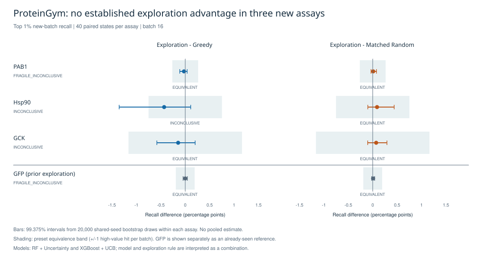
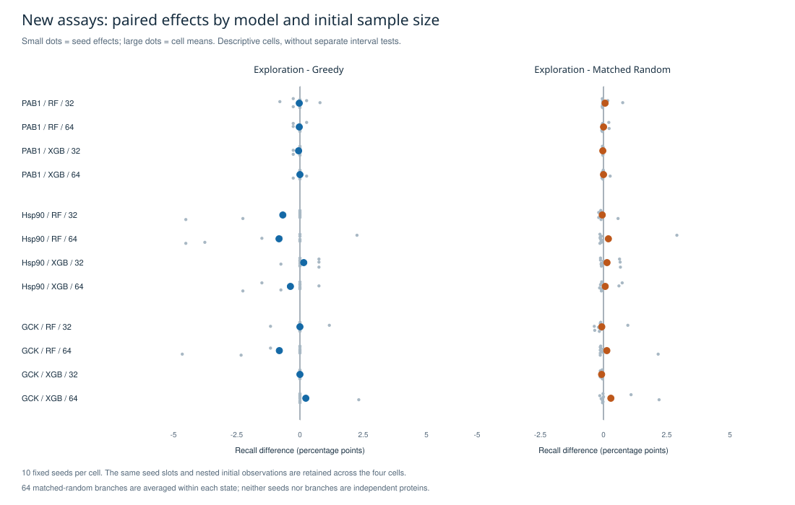

# M5C：ProteinGym 三项替代 assay 的探索结果

结果日期：2026-09-08。**修订范围的 ITERATION / L1 主体及结果核对已完成。**用户批准在同一 ProteinGym v1.3 中替换剩余三项，保留既有方法；本说明在实验后整理，实际配置和尝试记录在执行时产生。原四-assay 冻结协议及其正式确认状态没有被改写。

**三个新 assay 均未建立稳定的探索收益优势或复制的收益机制。**三项主比较中，E−G 点估计均为负、E−Matched Random 均为正，但六个 99.375% 区间全部跨零。选点变化明显，与收益成立是两件事。不能据此证明探索普遍无效、确定有害，或宣称复现了 A/B 的同一机制。

E = 探索，G = Greedy，M = 与 E/G 重叠程度匹配的随机分支。主指标为每批新增命中数除以该 assay 的实际 top 1% 高值集合大小，表中单位是 **recall 百分点**，不是命中率或 precision。

| assay | 样本数 | E−G：点估计 [99.375% CI] | E−M：点估计 [99.375% CI] | 既定分类 |
|---|---:|---:|---:|---|
| PAB1 | 37,708 | -0.02646 [-0.11243, +0.03968] | +0.01075 [-0.03410, +0.07714] | FRAGILE_INCONCLUSIVE |
| Hsp90 | 13,294 | -0.43233 [-1.35338, +0.11278] | +0.08870 [-0.10015, +0.43967] | INCONCLUSIVE |
| GCK | 8,570 | -0.14535 [-0.58140, +0.20349] | +0.07086 [-0.10311, +0.29115] | INCONCLUSIVE |



GFP 在图中作为已看过的探索参照单列，不参加新的三项汇总或未见数据声明。新三项之间没有主效应方向反转；尚不能把差异大小称为经过正式检验的 assay 异质性。没有合并 seed 做跨蛋白总体区间，也没有调用原四-assay cohort 分类器。

| assay | 每批 E 平均命中 | G 平均命中 | M 平均命中 | E/G 平均不同选点数（批量16） | 等价带（recall 百分点） |
|---|---:|---:|---:|---:|---:|
| PAB1 | 0.2250 | 0.3250 | 0.1844 | 13.125 | ±0.26455 |
| Hsp90 | 0.6750 | 1.2500 | 0.5570 | 13.550 | ±0.75188 |
| GCK | 0.4000 | 0.5250 | 0.3391 | 9.300 | ±1.16279 |

等价带沿用 C 的 ±1/ceil(0.01×N)，本轮主阈值无额外 ties，约相当于每批平均差 1 个高值命中；相对当前平均命中数，这个界值较宽。五项比较为规则内 EQUIVALENT；Hsp90 的 E−G 区间越过等价带下界，故为 INCONCLUSIVE。规则内等价不表示实际可互换，也不自动识别机制。GCK 的选点差异超过行为冗余条件，其余机制条件也未成立，因此两项比较等价而总体分类仍为 INCONCLUSIVE。

PAB1 在 top 0.5% 下 E−G 出现很小的正负翻转，触发预设 FRAGILE_INCONCLUSIVE。这是阈值敏感性标记，不是已建立的有害/有益反转。



分层图是描述性点估计。RF 绑定 Uncertainty，XGBoost 绑定 UCB，不能把组合间差异单独归因为模型或探索规则。每个 seed-slot 在两个模型及嵌套的 32/64 初始样本之间共享，区间反映 assay 内初始化/算法变异，不涵盖独立生物重复或原始实验测量不确定性。

## 敏感性与静态参照

| assay | 高值阈值 | 实际高值数 | E−G（百分点） | E−M（百分点） |
|---|---|---:|---:|---:|
| PAB1 | top 0.5% | 190 | +0.01316 | +0.04174 |
| PAB1 | top 1% | 378 | -0.02646 | +0.01075 |
| PAB1 | top 2% | 755 | -0.03974 | +0.00290 |
| Hsp90 | top 0.5% | 67 | -0.41045 | +0.14867 |
| Hsp90 | top 1% | 133 | -0.43233 | +0.08870 |
| Hsp90 | top 2% | 266 | -0.42293 | +0.03201 |
| GCK | top 0.5% | 43 | -0.40698 | +0.00727 |
| GCK | top 1% | 86 | -0.14535 | +0.07086 |
| GCK | top 2% | 172 | -0.14535 | +0.01408 |

敏感性仅报告点估计；PAB1 top 0.5% 实际 190 个高值（名义189，边界增加1），计算使用190。其余阈值无额外边界 ties。

静态 ESM1v_single 的 Spearman：PAB1 0.66236、Hsp90 0.39247、GCK 0.46388。静态 top 1% 分别选择378/133/86个候选，命中13/2/1个；预算不同于单步16，且静态排名不具备相同初始观测条件，只作描述，不能混入 E/G/M 同预算优劣结论。

## 实际完成范围及三项科学底线

- 三项各完成40配对状态、2,640分支，共 **120状态、7,920分支**；加上先前 GFP 是160状态、10,560分支，但证据身份分开。每项一轮固定接通及一轮 full，六次均成功，无失败实验或结果导向重跑。PAB1 执行时其余输入仍在下载，之后按固定 Hsp90→GCK 顺序完成。
- 配置保持420维 float64 组成特征、既有RF/XGBoost参数、初始32/64嵌套、seeds1729–1738、批量16、每状态64个 overlap-matched Random。G/E/M 的观测和预算相同；M 的随机重复在状态内处理。原C的20,000次成组 bootstrap、99.375%区间与分类条件保留；B采用98.75%区间，这个历史差异未改写。协作者M5D实际配置尚未核验。
- **样本与标签：**全部变体根据固定参考序列重建，唯一ID、候选/真值/membership精确覆盖，静态分数的ID和序列也精确对应、0不一致。标签统一为较高更好。GCK的8,570项错义变体与作者实测表按身份精确覆盖，数值在1e-9绝对/相对容差内全部一致；缺失/不一致为0，未使用另行提供的插补图谱。
- **真值边界：**ingestion和evaluator会读取完整真值以核对标签、提供允许的初始观测和评分；spawn worker只接收候选特征及已揭示观测，静态分数在模型退出后读取。固定已揭示观测、扰动未揭示真值的合成检查中，两种组合选点不变。未发现用未揭示真值指导选点或按结果改配置的证据。模型与evaluator属于同一Unix账户，属于代码/进程数据流隔离，不能宣称操作系统层无权读真值或绝对无泄漏。
- **比较与统计：**每项40状态精确覆盖，连接状态等于 full 首状态；共23,760项 recall 与命中数/实际高值数逐项一致，无缺失填零。三个assay的主效应、20,000次 bootstrap 区间和分类与服务器报告精确一致。分母/汇总算术另行实现；bootstrap和classifier复用原代码，不冒充独立实现。敏感性有至多约1e-19量级的浮点归约顺序差异，在既有1e-17算术容差内；PAB1一次过严的逐位比较失败已保留，不是实验失败，也未改变方法或结果。

## 来源、资源与复现

三项仍来自与 GFP 相同的 ProteinGym v1.3 归档。名单在读取新 assay 表现前按任务身份、独立研究与现有资源确定；HIS7 因仅特征矩阵即超出1.5 GiB上限而未纳入，未运行或按收益筛选。该便利样本不代表 ProteinGym 的随机样本。原敏感三项不属于此次修订执行，原正式四项也不能据此记为原样完成。

| assay | full 耗时（秒） | 峰值进程树 RSS（MiB） |
|---|---:|---:|
| PAB1 | 494.47 | 662.0 |
| Hsp90 | 365.05 | 426.0 |
| GCK | 346.77 | 382.7 |

普通用户、单worker/模型线程1；沿用1.5 GiB RSS、2h/assay、6h总实验上限。获取六个选定ZIP成员共47,934,628 bytes，另读GCK作者实测表654,182 bytes及少量元数据；在100 MiB总下载和2 GiB新scratch上限内。未安装依赖、扩容或改旧数据权限。使用现有Python3.11.2、NumPy2.4.6、sklearn1.9.0、XGBoost3.2.0。

执行来源是基础提交 `5c0119df4d4fdef62ca616e7199b4cb8061eb4a9` 加各 execution.json 记录的实际修改文件SHA；科学入口SHA为 `adc76d2487e2ca3eeebf1e4d34d53c6aa7c25e2076cd54cf250f01129618b3d7`。v2/v3的方法与科学入口字节相同。后来仓库提交是事后集成标识，不能称为执行时commit。ingestion和GCK核验入口仅格式化，归一化AST相等，原/现SHA分别保留。

PAB1使用早期单assay输入封装 `8baa32b5…0c76`，Hsp90/GCK使用最终三assay封装 `cfe2e613…3d10`；五种PAB1输入产物的SHA、大小和行数逐项相同，见 [输入绑定](pabp-input-binding.json)。不能把最终封装SHA回填为PAB1实际输入。保留完整原始记录于服务器，仓库只放紧凑汇总、配置、身份摘要及图表；没有逐样本序列、标签、候选排名、COS发布或证据晋升。JSON复用已有聚合形状，仅作L1结果载体，不声明符合原四项正式证据schema。

- [结果摘要](summary.json)、[实际尝试索引](attempts.json)、[输入身份](input-identity.json)、[来源与哈希](provenance.json)、[有效性检查](checks.json)。
- [GCK实测标签核对](gck-label-reconciliation.json)、[静态分数样本身份核对](static-sample-identity.json)。
- [ProteinGym固定元数据](https://github.com/OATML-Markslab/ProteinGym/blob/62eab5b3c83a3727b5b57bfbe377b24ef7545ccc/reference_files/DMS_substitutions.csv)。
- [PAB1原论文](https://pmc.ncbi.nlm.nih.gov/articles/PMC3851721/)（CC BY-NC 3.0）、[Hsp90原论文](https://elifesciences.org/articles/53810)、[GCK原论文](https://pmc.ncbi.nlm.nih.gov/articles/PMC10131484/)及[作者数据](https://zenodo.org/records/7636310)。仅本研究使用数据；不将ProteinGym的MIT许可解释为上游数据重新许可。GCK名称采用原论文/变体身份，未沿用元数据中误写的regulatory protein描述。

从本PR源码根目录使用既有项目Python环境复算任一assay（输出必须是新路径）：

```sh
assay=PABP_YEAST_Melamed_2013
PYTHONPATH=src python scripts/verify_m5c_benign_iteration.py \
  --aggregate "docs/results/m5c-benign-20260908/$assay/aggregate-input.json.gz" \
  --connection "docs/results/m5c-benign-20260908/$assay/connection-state.json.gz" \
  --output /tmp/m5c-benign-verification-new.json
```

该命令只接受聚合汇总和连接状态，不接受候选/特征/代理/真值路径。压缩打包的六个文件均已逐字节解压回读，SHA与用于本轮复算的原文件一致，无需重复启动实验。绘图采用既有文档环境ReportLab，不增加项目运行依赖：

```sh
python scripts/plot_m5c_benign_iteration.py \
  --results docs/results/m5c-benign-20260908 \
  --gfp-reference docs/results/m5c-gfp-20260908/verification.json \
  --output /tmp/m5c-benign-figures-new
```

独立上下文的只读科学建议复核接受上述有限探索性陈述，未发现会使当前主结论无效或需要重跑的实质问题；模型与策略组合、推断单位及“等价不等于机制”限制已经写入本说明。该建议复核没有重读原始逐样本真值，也不冒充指定协作者的GitHub正式 approval。

修订范围要求的独立assay比较、静态描述和受限跨assay解释已经完成。没有形成稳定有利的机制模式，多轮确认的继续条件未满足，本轮到此停止。仓库同步与工程CI单独记录在PR；Draft/独立协作者审核、原四项正式确认、合并及证据晋升不由本结果自动完成。
