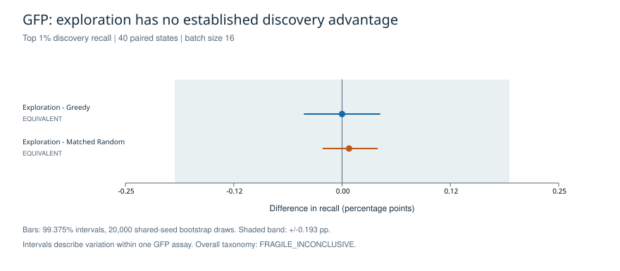
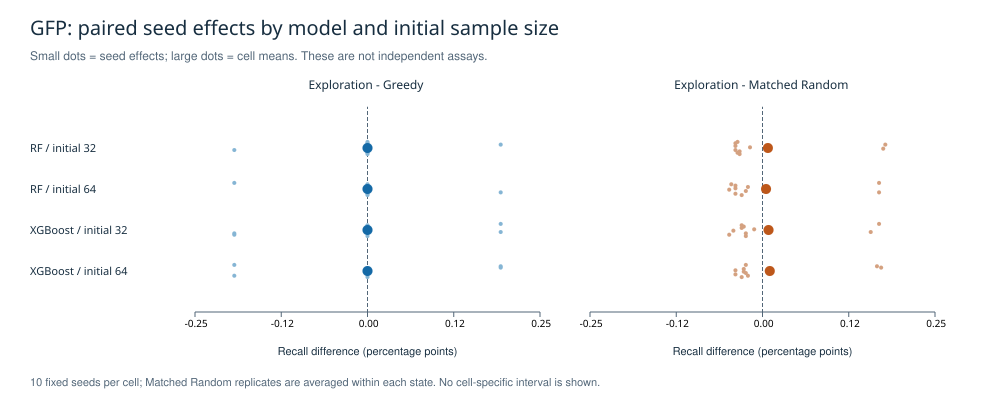

# M5C GFP 首版探索结果

结果日期：2026-09-08。阶段：**ITERATION / L1**。本说明在实验完成后整理，记录真实执行，
不是事前冻结协议、独立审核或正式证据晋升。沿用 PR #103 的方法，实现范围仅为 GFP；
原四-assay M5C 确认与跨 assay 复制结论尚未完成。

## 结论

**FRAGILE_INCONCLUSIVE：当前 GFP 切片没有建立探索策略的发现优势。**
top 1% 的两项比较均落入 C 既定等价带，但敏感性阈值下 E−M 出现微小方向变化，
触发原分类器的 `FRAGILE_INCONCLUSIVE`。这不表示发现了显著负效应，也不能改写为探索有效。
不为改善显著性增加 seed、模型或更换主阈值。

| 主比较 | recall 差（百分点） | 99.375% 区间（百分点） | 原规则分类 |
|---|---:|---:|---|
| 探索 − Greedy | 0.00000 | [−0.04344, +0.04344] | EQUIVALENT |
| 探索 − Matched Random | +0.00807 | [−0.02179, +0.04050] | EQUIVALENT |

等价界值为 ±1/518，即 ±0.19305 个百分点，相当于每批平均多或少 1 个高值命中。
当前探索与 Greedy 每批平均均仅命中 0.2 个，Matched Random 为 0.1582 个。
因此该等价带相对当前发现率偏宽；规则内等价不等于证明两种策略在实际用途上可互换。



| 模型 / 初始样本数 | 探索平均命中 | Greedy 平均命中 | Matched Random 平均命中 | E/G 平均差异数（每批 16 个） |
|---|---:|---:|---:|---:|
| RF / 32 | 0.2000 | 0.2000 | 0.1594 | 16.0 |
| RF / 64 | 0.2000 | 0.2000 | 0.1734 | 16.0 |
| XGBoost / 32 | 0.2000 | 0.2000 | 0.1547 | 14.9 |
| XGBoost / 64 | 0.2000 | 0.2000 | 0.1453 | 14.8 |

选点明显不同，但均值收益没有显示清楚优势；这不能仅凭行为差异解释为有效探索。



| 高值阈值 | 实际高值数 | E−G（百分点） | E−M（百分点） |
|---|---:|---:|---:|
| top 0.5% | 259 | +0.00965 | −0.00060 |
| top 1%（主） | 518 | 0.00000 | +0.00807 |
| top 2% | 1,035 | −0.03140 | +0.00593 |

敏感性表只有点估计。静态 ESM1v_single 的 Spearman 为 0.09813，静态 top 1% 的
518 次选择命中 0 个；其预算不同于单步 16，不能纳入 E/G/M 的同预算排行榜。

## 已执行配置与有效性

- `GFP_AEQVI_Sarkisyan_2016`，51,714 个公开候选，DMS_score 越大越好；420 维既有序列组成特征。
- RF + Uncertainty、XGBoost + UCB；初始 32/64 嵌套；固定 seeds 1729–1738；批次 16；
  每状态 64 个 overlap-matched Random；完整 40 状态、2,640 分支，无缺失或择优筛选。
- 同状态 E/G/M 共用已揭示观测与候选池。保留 C 原有 20,000 次重采样、99.375% 区间，
  同一 seed-slot 抽样同时覆盖两个模型与嵌套初始规模，随机重复在状态内处理。
  40 个状态和 64 个随机重复都不是独立生物重复，区间仅反映 GFP 内的初始化/算法变异。
- 真标签、候选、membership 按 ID 校验唯一性和精确覆盖；高值集合包含全部边界 ties，
  本次三个阈值均无额外边界 ties。7,920 项 recall 均与命中数/实际高值数一致。
- spawn 模型进程只接收候选特征和已揭示观测；truth 留在 evaluator。
  静态代理在模型 worker 退出后才读取。合成数据中固定已揭示值、改变未揭示真值，
  两模型选点不变。这些检查提供本次入口的有效性依据，不冒充完整安全证明。
- 一个固定接通状态的结果与完整运行首状态完全一致。汇总仅用已封存的状态指标复算；
  主效应、20,000 次 bootstrap 区间和分类与服务器逐项一致。
  分母和汇总算术另行实现，bootstrap/classifier 复用原代码，未声称独立审核。
- 普通用户、单 worker/模型线程 1，RSS 上限 1.5 GiB、wall 上限 2 小时；
  主体成功终态耗时 575.41 秒，峰值 RSS 805,425,152 bytes（约 768 MiB）。
  Python 3.11.2、NumPy 2.4.6、sklearn 1.9.0、XGBoost 3.2.0；无新安装。

## 复现与来源

实际方法基础为 `d563147a1b036066f01bf17bcf6ece14d0246126`，运行 `full-001` 使用当时独立入口：
`e4c434e2cf29ff10ee50afc9060653fb4b132a25994662bc2e7cac28a3927860`。
仓库中的入口是在结果完成后格式化整理的副本；import 名称排序归一后 AST 与执行副本相同，
但文件 SHA 不同，不能将后来提交的 commit 冒称运行来源。具体身份见 [provenance.json](provenance.json)。

这里保存紧凑分支汇总、执行记录和图表，不保存候选序列、逐样本真值或特征矩阵。
完整服务器输出的 assay-report SHA 为
`ee984f448a412f8a6df5d941a30a23eb1ec5b7a2183baaf33a6bc32512511407`。
原始输入及不可覆盖的执行目录仍由现有服务器保存；无 COS 发布或四-assay 证据晋升。

从本 PR 源码根目录可离线复算（既有项目 Python 环境）：

```sh
PYTHONPATH=src python scripts/verify_m5c_gfp_iteration.py \
  --aggregate docs/results/m5c-gfp-20260908/aggregate-input.json.gz \
  --connection docs/results/m5c-gfp-20260908/connection-state.json.gz \
  --output /tmp/gfp-verification-new.json
```

输出路径须不存在。主比较和分类应与 [verification.json](verification.json) 一致；
耗时和 verifier 文件 SHA 是执行记录，不要求跨版本相同。
该命令不接受 candidate、feature、proxy 或 truth 路径。

绘图使用已有文档工具环境中的 ReportLab，不加入项目运行依赖：

```sh
python scripts/plot_m5c_gfp_iteration.py \
  --verification /tmp/gfp-verification-new.json --output /tmp/gfp-figures-new
```

有授权的现有输入可运行 `scripts/run_m5c_gfp_iteration.py --input-root INPUT_ROOT
--attempt-root NEW_ATTEMPT_ROOT --mode full`；不得复用成功输出目录。本次工作已完成实验，
此命令仅为可复现说明，不要求或自动发起重跑。

本地检查记录见 [checks.json](checks.json)：6 项针对性检查、Ruff、mypy 和本地仓库检查通过；
服务器导出副本缺少 Git 元数据，后续宽测试又遇到 SSH 中断，因此完整 `make check` 尚不能记为通过。
这属于提交前工程验证的剩余项，不能用针对性测试或实验成功替代。A/B 的指标含义已衔接；B 的 98.75% 区间与 C 的
99.375% 区间区别保留。M5D 协作者的实际配置未核验，不据此声称 A/B/C/D 全部一致。
