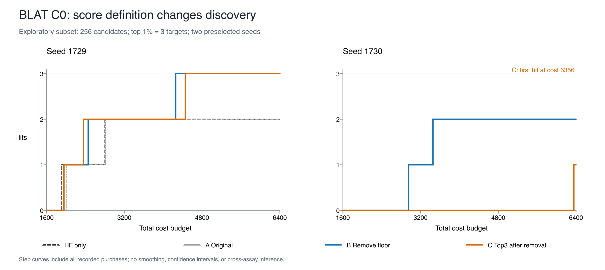

# M6 E4 结果、原因核查与 BLAT C0 评分消融

2026-09-15；开发期 L1 事后原因分析。本文同步已完成实验及独立科学咨询接受的有限声明，
不修改原 E4 判定，也不宣称 M6/E5 完成。

**目前已验证一个具体机制：在所查 BLAT C0 状态、当前 RF 和三点更新近似下，效用中的
当前最好观测值下限使信息分数恒为零；去掉该下限能恢复 LF 选择，并在原定两条完整轨迹中
增加同预算高价值发现。尚不能推断评分定义大概率解释整个 M6 未达预期。**

## 研究问题与各阶段完成情况

M6 研究固定总成本下，低保真（LF）信息在什么质量、目标区域失真和成本条件下能够增加
高保真（HF）确认的高价值发现。比较 HF-only、固定比例、硬预筛和成本感知联合选择。
LF 本身不计发现；初始观测与每次 LF/HF 购买均计费。

| 阶段 | 目的 | 完成与结论 |
| --- | --- | --- |
| S1 / synthetic 工程切片 | 接通付费观测、选择和评价，验证可见性与计费 | 已实现、测试并随 PR #108 合并；不作为真实科学结果 |
| S2 / E4 可控代理实验 | 分别改变整体相关、高值区镜像和 LF 成本，检查四策略的同成本发现 | 四公开任务、五 seed 完整执行；总体 `UNSTABLE / REVISE` |
| E4 既有产物核查 | 区分执行/统计错误与实际方法行为、代理条件 | 保存产物一致性通过；发现任务间零评分、LF 使用和高值区信息差异 |
| BLAT 评分消融 | 检验最好值下限是否造成零评分，以及改分数是否增加发现 | 原定同状态诊断和四条新轨迹已完成；有限条件下机制与小样本正方向成立 |
| S3 / E5 真实代理 | 用真实 zero-shot 等信息检验实际条件下的价值 | 未执行；不能由模拟代理结果推断效果 |
| S4 / M6 总体结论 | 汇总任务条件、收益/风险与未完成边界并正式验收 | 尚未完成；PR 实现批准和独立咨询不代替 Gate B |

E5 不必等待 E4 阳性或原因完全解释。其自身的代理、方向、coverage/missing、split/leakage
和成本身份仍需明确；如果共用链路有科学有效性错误，应先修正。本次核查未发现要求重跑
当前小实验的未关闭科学错误，也没有启动 E5。

## 原 E4 得到了什么

研究身份 `e4-proteingym-20260914-001`，实际源码
`fd68935bf97cd7811c66f733066aa8e3677cb1dc`。四个固定开发子集为 BLAT、CAPSD、GFP、SPG1，
每个 256 候选，seed 1729–1733。260 条唯一轨迹对应 320 逻辑条目，其中 60 条为 HF-only 复用。

48 项主比较：**5 positive、1 negative、27 unstable、15 inconclusive**。
cost_aware 的 16 项为 9 unstable、7 inconclusive；四任务均未通过 C0 正、C2 负及
至少 4/5 seed 负向的联合机制标准。这是原定描述性方向规则，不是多重校正显著性检验。

正方向出现在 BLAT hard_prescreen C0/C3、SPG1 fixed_ratio C0/C3 和 hard_prescreen C2；
负方向为 CAPSD hard_prescreen C1。因此原 E4 不是所有策略、所有任务均无收益，
但没有建立预想的共同机制。后续改评分的结果不把原方案回写成通过。

## 原因核查：异常并不相同

C0 的全局 Pearson 约 0.8，LF/HF 成本为 1/100，预算 6400，初始 16 HF 与付费 16 LF。
以下数目按五 seed 顺序；分数决策次数是程序事件，不能作为独立重复数。

| 任务 | 零价值/贪心回退次数 | 每条轨迹 LF 购买数 | top1% recall 对 HF-only 平均差 |
| --- | --- | --- | ---: |
| BLAT | 235/235 | 16/16/16/16/16 | 0 |
| CAPSD | 223/247 | 22/17/16/16/21 | +0.0667 |
| GFP | 93/1306 | 250/242/207/216/246 | −0.0667 |
| SPG1 | 197/495 | 17/112/16/180/17 | +0.2667 |

BLAT 后续全部回退贪心，未追加 LF，不能解读为充分利用 LF 后证明其无价值。
GFP 已大量购买 LF，后续 225 次 HF 中 132 次不是当时预测均值第一名，却仍不稳定。
CAPSD 的相似零值行为尚未接受本次对应评分干预；SPG1 的 LF 使用随初始化变化。

GFP C0 高值 10% 内 Spearman 为 `[0.130, −0.361, 0.162, −0.043, 0.246]`，
两个 seed 原本已有负局部排序。LF 排名前 25% 保留的 3 个 top1% 目标数，
C0 为 `[2,0,3,1,1]`，C2 为 `[2,2,0,2,2]`。
所以全局高相关不保证目标区域信息可靠；局部镜像也不一定从“好排序”变成“坏排序”。
C2 同时改变实际全局 Pearson，不能作为只改变局部偏差的纯因果对照。
这些保存产物诊断尚未得到独立的 GFP 代理消融确认。
完整任务/条件/策略紧凑指标与代理诊断见 [e4-diagnostics.json](e4-diagnostics.json)，保留全部
已保存分组和五 seed 顺序（1729–1733）。HF-only 的零信息分数不能当作成本感知策略的回退；
其中 scorer_calls、fallback 等计数的含义分别保留，不把事件当独立样本。

## BLAT 小型消融：只改变评分效用

固定原 BLAT C0 的 256 候选、420 特征、RF ensemble、bootstrap、初始化、
LF/HF=1/100、总预算 6400。两条完整轨迹采用预先固定的 seed 1729、1730；
不是根据新增终点挑选 seed，但任务本身因已知异常被选入事后分析。

| 方案 | 效用定义 |
| --- | --- |
| A 原评分 | `max(best_observed, max_remaining_predicted_mean)` |
| B 去下限 | 剩余候选的最大预测均值，移除 `best_observed` 下限 |
| C 再 top3 | 在 B 上改用剩余候选 top3 预测均值之和 |
| HF-only | 复用原单保真对照并回放核验 |

C 的 3 来自预定的 `ceil(256 × 1%)`，不读取真值 top 成员；它也不等于精确期望 recall。
最好值下限是原评分定义的一部分，不是另一项独立故障；B 去下限与 C 再 top3 是两项不同消融。
B/C 同时改变 HF 和 LF 的评分，随后信息、拟合状态和 HF 选择均会变化。
A/HF-only 是原轨迹复用与回放，不是新的一次完整 RF 重训对照。

### 相同状态的机制

从五个原 seed 的原 A 轨迹各取评分位置 0/16/32/46，共 20 个嵌套状态：
A 20/20 零分数回退，B/C 各 20/20 选择 LF。
这些状态不是 20 个独立实验。

真实保存 ensemble 与逐查询三点期望的另一公式实现复核表明：可选 HF 查询的模拟最大值
减 best 均在 `[−0.89034350, −0.00704217]`，LF 在 `[−0.90731824, −0.08487982]`。
基线与模拟值均低于 best，故原效用始终等于同一 best，改善量为零。
移除下限足以解除所查状态的平坦效用；恢复的正分数远高于预定舍入噪声截断量级。

这是**当前模型/更新近似下的条件性代数机制**，不是已证实的实现 bug。
模型校准、预测尾部和三点近似为何给出这些情景，其独立贡献尚未分离。

### 完整终点：6400 预算内 HF 确认的 top1% 目标

本子集 top1% 只有 3 个目标，两 seed 的初始 16 HF 均无命中。

| 方案 | seed 1729 命中 | seed 1730 命中 | 平均 recall | 每 seed HF/LF | 实际终止成本 |
| --- | ---: | ---: | ---: | --- | ---: |
| A | 2/3 | 0/3 | 33.3% | 63/16 | 6316 |
| HF-only | 2/3 | 0/3 | 33.3% | 64/0 | 6400 |
| B | 3/3 | 2/3 | 83.3% | 61/256 | 6356 |
| C | 3/3 | 1/3 | 66.7% | 61/256 | 6356 |

B−A 配对 recall 差 `[1/3,2/3]`，平均 +0.5；C−A 为 `[1/3,1/3]`，平均 +1/3。
两者通过事先固定的两 seed 小样本正方向规则（两条均严格正且平均至少 0.05），
不等于统计显著、新 seed 确认或跨任务泛化。C−B 为 `[0,−1/3]`，判定 inconclusive，
不能说 C 稳定更差或与 B 等价。相对 HF-only 的上述终点差值相同，但原轨迹并不相同。

B/C 都购买了全池 256 LF（含初始 16），相对 A 多 240 LF、少 2 HF；
B 后续 45 次 HF 中 41/38 次非当前均值第一，C 为 42/44 次。
收益不是多做 HF 得到的，但不能拆成 LF 获取、LF 改善预测、HF 选点的独立贡献。
实际行为接近先做全池廉价 LF 筛查再 HF，尚未证明选择性多轮 LF 获取优于全量预筛。

### 预算与阈值敏感性

每格为 `[1729,1730]` 命中数；均评价同一 6400 轨迹，不是针对不同预算重跑/优化。

| 方案 | 成本 3200 | 成本 4800 | 成本 6400 |
| --- | --- | --- | --- |
| A / HF-only | [2,0] | [2,0] | [2,0] |
| B | [2,1] | [3,2] | [3,2] |
| C | [2,0] | [3,0] | [3,1] |

B 在 4800 已两条均超过 A；C1730 直到 6356 最后一次 HF 才首次命中，收益对预算敏感。

| 方案 | top0.5%：2 个目标 | top1%：3 个目标 | top2%：6 个目标 |
| --- | --- | --- | --- |
| A / HF-only | [1,0] | [2,0] | [3,1] |
| B | [2,1] | [3,2] | [6,4] |
| C | [2,1] | [3,1] | [6,1] |

B 在三个既定阈值均两条超过 A；C 的 top2% 第二条与 A 相同。阈值不是独立重复，C 的 k 始终为 3。
达到 top1% recall 50%（至少 2/3）所需成本为 A `[2816,未达]`、HF-only `[2800,未达]`、
B `[2456,3456]`、C `[2356,未达]`；未达按删失保留，不能填 6400 后取均值。
B/C 都找到子集最大值，但找到最好点不等于发现全部高价值点。

图使用全部保存成本点，无平滑或置信带；仅展示初始 16 HF 后的 1600–6400 区间。
A/HF-only 曲线部分重合。原图及 [SVG](discovery-curves.svg) 保持审查版本字节。
全部紧凑数字见 [results.json](results.json)。

## 可以支持什么，哪些原因仍未排除

| 解释 | 当前证据强度与边界 |
| --- | --- |
| BLAT 原评分受最好值下限压平 | 所查真实状态有直接公式证据；B/C 同状态解除，B/C 两条完整轨迹净发现增加 |
| 整个 M6 的主要原因就是评分定义 | 未建立；只干预一个已知异常任务，GFP 的大量 LF 使用与不稳定结果不能由“始终零分”解释 |
| 改善来自 LF 的额外决策价值 | 尚未隔离；LF 信息、训练状态及 HF 评分共同变化，不能将联合干预当作纯 LF 因果效应 |
| 模型/表示/校准/更新近似造成限制 | 未排除；评分公式与 RF/三点情景共同决定平坦区，没有单独消融这些贡献 |
| 代理信息与高价值区域不匹配 | GFP 保存产物支持这一诊断，但未做对应干预；C2 还改变全局 Pearson |
| 稀疏目标、初始化、预算和成本影响结果 | 已有描述性敏感性；只有 3 个主目标、两条消融 seed、固定 1:100，不能给出一般适用条件 |
| top3 比最大值更贴合发现目标并更优 | 未建立；C 无已确立的额外优势，部分改善到最后一次 HF 才出现 |
| M5 与 M6 有同一根因 | 未建立；共享“全局预测/代理质量不能替代发现价值”的问题，但数据子集、模型和干预不同 |

可用于论文的有限表述：

> 在固定 BLAT C0 开发子集和两条预定初始化轨迹中，移除获取效用中的当前最好值下限，
> 解除已核验状态上的零信息评分，并在固定计费预算内提高高价值命中。该结果支持评分效用
> 与候选发现目标存在条件性不匹配的解释；尚未区分信息获取与 HF 选点的贡献，也未建立跨任务一般性。

本轮没有新 seed 完整独立重训或跨 assay 泛化，不能达到“经复现和泛化检验的整体决定性结果”。
保留 B 的有限正方向与零值机制即可完成当前小实验；本文件不启动后续实验。

## 复核、续算与证据身份

原 E4 核查覆盖 1151 个绑定文件、320/260 轨迹索引、51260 事件、24060 保存评分状态、
全部指标点、48 主比较及 4 机制向量；357249 项一致性检查通过，独立咨询另复算 7856 项紧凑检查。
这验证保存产物内部一致性，不是从原始 ProteinGym 独立重建或完整 RF 重训。

原 BLAT attempt 在 1200 秒上限停止，保留 3 条完整和 1 条部分轨迹；当时未完成新终点评价。
后续获明确授权后在新目录续算，复用 1136 次保存评分、补 4 次缺失评分，另作首/末 2 次
fresh-fit 桥接，ensemble 逐值一致。原 1191 文件字节前后不变；失败与成功均保留。
四条新轨迹均锁定后才评价，未按终点筛选保留轨迹。

本轮真实数组运行内核对：20 状态 × 3 评分 × 2 fidelity 的 120 向量，加四条新轨迹
1140 状态 × 2 fidelity 的 2280 向量，以另一公式实现复算；最大绝对差 HF 8.88e−16、
LF 4.44e−16。7 条原参考的 331 评分状态回放核验；8 行 × 3 阈值的全部曲线、成本与删失
经另一个集合计数实现核验。续算约 65.867 秒、峰值 174488 KiB，新产物 15689957 字节。

独立 fresh 科学咨询接受当前 L1 有限声明：738 项紧凑断言、121 项分析交叉核对与 8 条图线通过。
联合 HF/LF 干预、单任务两 seed 的两项 MATERIAL 限制在声明层面关闭；审查者未亲自从原始
ensemble/truth 重建完整链路，列为 DEFERRED。运行内另一公式核验与独立审查者紧凑复算
须分别报告；检查次数不是科学样本数。咨询不等于指定协作者正式批准或证据晋升。

[sources.json](sources.json) 保存原执行、完整报告、声明和独立审查的 SHA256；
[SHA256SUMS](SHA256SUMS) 绑定本目录紧凑文件。本目录不包含原始候选/真值、完整 ensemble、
事件或模型，因此不是可独立执行的完整复现发布包。

外部权威入口：

- [Issue #107 的 E4 完成结果](https://github.com/QUHONGYE-gif/protein-candidate-discovery-benchmark/issues/107#issuecomment-5673275091)。
- [PR #108 实现批准](https://github.com/QUHONGYE-gif/protein-candidate-discovery-benchmark/pull/108#pullrequestreview-5194105109)，已于 2026-09-14 合并；不是 E4/E5 结果批准。
- [固定执行源码的 M6 实施计划](https://github.com/QUHONGYE-gif/protein-candidate-discovery-benchmark/blob/fd68935bf97cd7811c66f733066aa8e3677cb1dc/docs/M6_IMPLEMENTATION_PLAN.md)。其执行前“尚未完成”措辞是历史状态，当前完成范围见本文。

2026-09-15 同步前核验 Issue #107 仍 OPEN / ready-for-human，原 PR #108 已合并。
本结果包作为独立文档 PR 提交，并在原 PR #108 与主 Issue #107 评论关联。发布仅使已有结果
可供协作者查阅，不构成正式结果批准、Gate B、合并/关闭或新实验授权。
