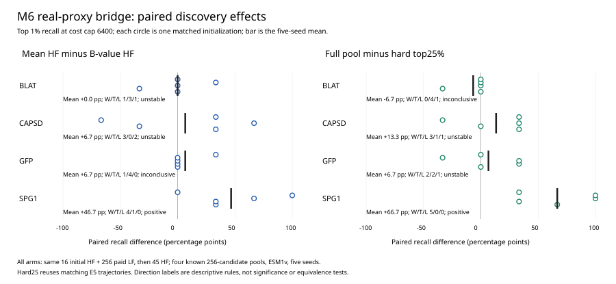

# M6：评分复验、真实代理 E5 与原因分析结果

固定总成本下，低保真信息能否增加高价值发现，取决于信息怎样进入候选筛选和后续高保真选点。本组开发实验识别了部分可干预的性能差距，同时保留明显的任务与终点差异；没有建立普适收益或M6统一根因。

本包接续[原E4诊断及BLAT两seed消融](../m6-e4-diagnosis-20260915/README.md)，包含其后的评分复验、共同完整LF政策消融、真实ESM1v E5和真实代理政策桥接。相关对象为[Issue107](https://github.com/QUHONGYE-gif/protein-candidate-discovery-benchmark/issues/107)、[结果PR111](https://github.com/QUHONGYE-gif/protein-candidate-discovery-benchmark/pull/111)。E4/E5及列明的原因单元均已完成；正式科学验收与Gate B仍待协作者决定。

## 研究顺序和结果

| 单元与目的 | 主要结果 | 结论限度 |
|---|---|---|
| 原E4：可控LF条件下比较四策略 | 48主比较5positive/1negative/27unstable/15inconclusive；A成本感知无positive | 原UNSTABLE / REVISE保留；净政策差包含费用、HF次数与学习变化 |
| 原BLAT两seed：检查原A全零回退 | 去best下限B激活LF；原两seed召回平均提高50pp | 最好值下限是评分定义；该小样本结果未足以证明整体修复 |
| [60轨迹评分复验](score-replication.md) | B−A：BLAT约0、CAPSD−40、GFP−40、SPG1−20pp；47/80状态重现A零分条件，B在80/80选择LF | 行为机制可复现，但B的收益没有稳定复现；不采用B默认修复 |
| [40轨迹模拟代理共同LF](synthetic-policy.md) | 相同信息与HF机会下，均值−B：BLAT+40、CAPSD+46.7、GFP+6.7、SPG1+66.7pp；除GFP外满足预列正方向 | 识别共同起点后完整HF政策效应，非LF纯效应或全程同状态 |
| [140唯一轨迹E5](e5-real-proxy.md) | 真实ESM1v下BLAT硬筛选比HF-only高40pp（3胜2平）；CAPSD硬筛选为负；原A八比较无正平均差 | 24主比较0positive/2negative/4unstable/18inconclusive；不是所有真实代理无效 |
| [40新轨迹真实代理桥接](bridge-report.md) | 均值−B仅SPG1主方向为正；SPG1去筛选五seed全部增加发现 | 之前三个任务的政策优势未整体转移；去筛选不是普遍改进 |

上述单元并不都是独立重复：原代理抽样、任务面板和部分seed复用；E5有20个HF-only跨成本引用，桥接复用20个E5 hard25参考。来源和核验范围见[PROVENANCE](PROVENANCE.md)。

## 最新真实代理干预

各组共享16HF+256LF初始付费状态，模型/first ensemble完全相同；再进行45次HF购买，总61HF/256LF、成本6356、上限6400。主终点为每池3个top1%目标的召回；五seed按任务配对。

| Assay | 均值HF−B信息HF | 全池均值−hard25 |
|---|---|---|
| BLAT | 0pp，1胜3平1负 | −6.7pp，0胜4平1负 |
| CAPSD | +6.7pp，3胜2负 | +13.3pp，3胜1平1负 |
| GFP | +6.7pp，1胜4平 | +6.7pp，2胜2平1负 |
| SPG1 | +46.7pp，4胜1平 | +66.7pp，5胜 |

只有SPG1的两个主比较满足预列正方向。SPG1硬筛选排除了全部3个目标，初始以后新增命中为0；移除后五seed新增[2,1,3,3,1]，说明解除集合限制在本条件下确实转化为发现。去筛选优势在top0.5%/1%/2%均满足方向规则。均值对B的top0.5%仅3胜2平，不声称全部阈值稳定。

CAPSD、GFP的hard25则已在全部seed找到最佳候选（simple regret=0）；去筛选后均值召回的某些提高，并不代表最佳值更好，且top0.5%平均召回下降。因此“多找高价值候选”“找到最佳候选”和“更快达到目标”须分别报告。

[配对差PDF](bridge-paired-effects.pdf) · [完整成本曲线](bridge-curves.pdf) · [全部24阈值比较、逐seed与删失](bridge-tables.md) · [机器可读摘要](bridge.json) · [科学声明](bridge-claim.md)

## 目前能解释与尚不能解释的原因

- **有直接支持：** 原A在部分状态因best下限与有限fantasy支持而零分；信息分数的改变能明显改变采购/选点。共同信息与HF次数下，HF规则本身可影响发现，真实代理下SPG1有方向支持；SPG1硬筛选的不可达目标和移除干预形成一致证据。
- **已被收窄：** 去下限不是通用修复；模拟代理下三个任务的HF政策优势未整体迁移到真实代理；全局相关性、LF数量、候选未被过滤均不足以单独保证发现收益。
- **仍未独立拆分：** RF均值/不确定性质量、有限三点近似、价值效用与累计top-hit目标差别，以及代理上尾分辨率各自的因果贡献。未建立M5/M6统一根因、未见assay泛化或所有预算/真实成本下的规律。

[完整E5三阈值/两成本/删失表](e5-tables.md)、[真实代理筛选可达上限](e5-prescreen-reachability.json)、[E5曲线](e5-recall-curves.pdf)保留了负向和不明确结果。条件节省只针对共同达标配对，不能作整体节省或真实货币解释；轨迹预算前缀不是独立总预算实验。

## 验收状态

实现、运行完整性、科学结论和正式批准分别判断。本包提供完成的L1开发结果及独立咨询材料，不回填原Gate A执行例外，不替代指定非作者QUHONGYE-gif的正式审阅，不关闭Issue107或自动合并/晋升。咨询的实际覆盖与当前状态见[REVIEW_SUMMARY](REVIEW_SUMMARY.md)。

四任务均为已知256候选开发池，seed不是独立蛋白；4/5及5pp方向规则不是显著性/等效性检验。真实桥接与旧模拟桥接的seed/运行环境不同，不能将跨轮差异单独归因于proxy。原始候选/标签、完整轨迹和ensemble未纳入Git；本包是紧凑结果摘要，非全链可执行复现发布包。
